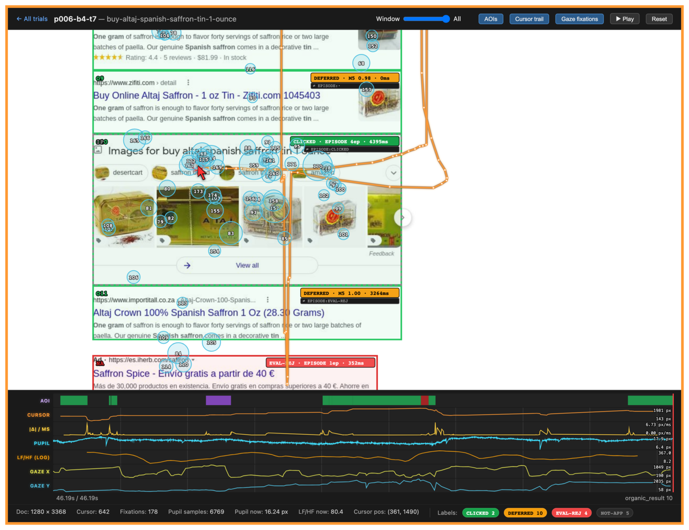
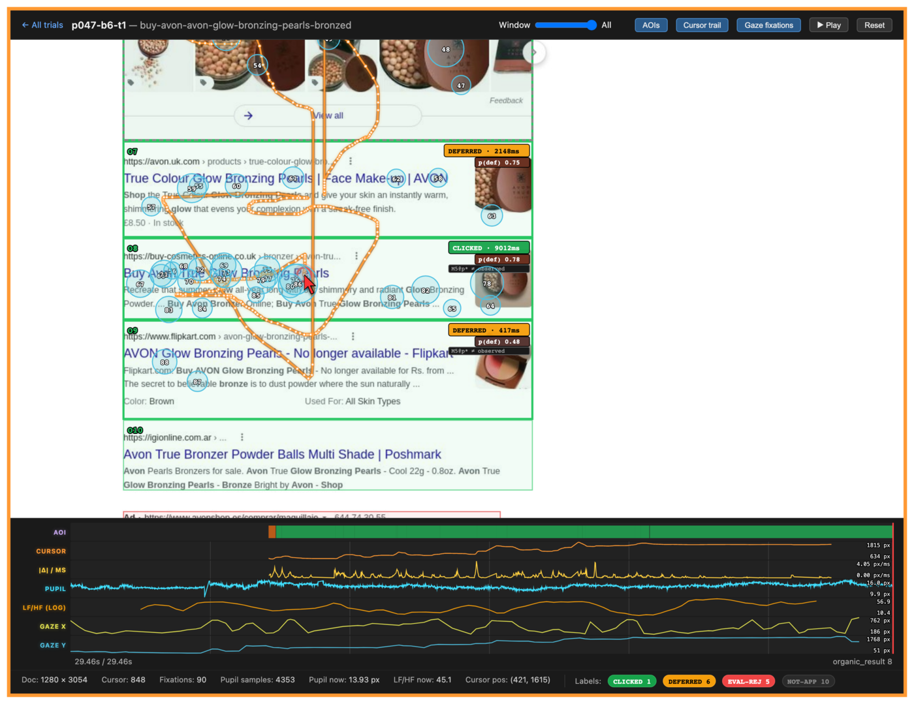
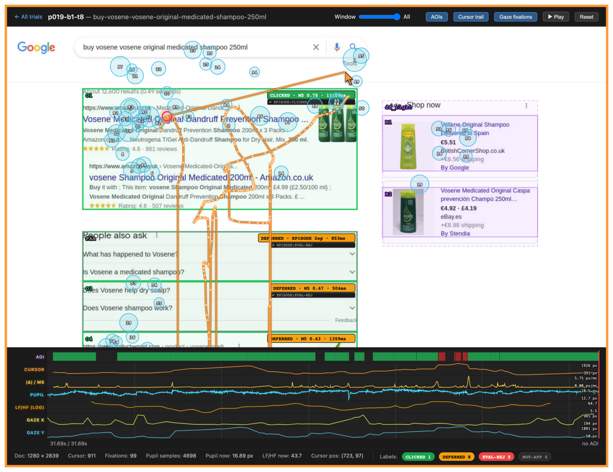
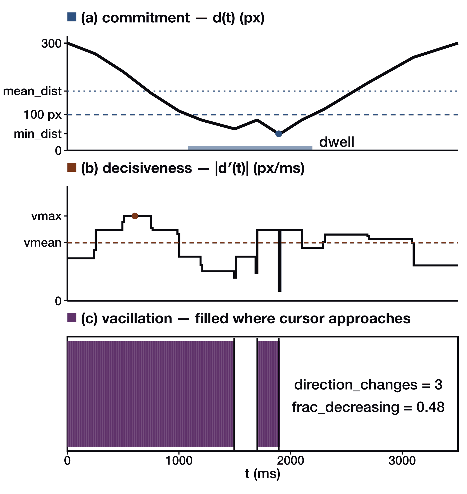

# Approach/Retreat

Records cursor visits and viewport exposure for individual results,
without requiring an eye tracker. Drop-in instrumentation for ranked-list
pages: search result pages, recommendation feeds, comparison tables, product grids.

Two channels:

1. **Approach-retreat episodes** *(desktop, cursor)* — per-result enter /
   dwell / exit behaviour, classified into a four-class taxonomy:
   **clicked**, **deferred**, **evaluated-rejected**, and
   **not-approached**. These are operational labels; cursor behavior alone
   does not establish examination, intention, or relevance. Their use as
   ranking supervision is a research question. Also produces the
   seven-feature M4-7 vector used by the click-prediction and deferred-class
   classifiers.
2. **Viewport dynamics** *(any device, scroll-only)* — per-AOI residence,
   MRC/IAB viewability, and scroll kinematics. No cursor required; works
   wherever `scroll` events + DOM bounding boxes are available, including
   mobile and feed surfaces.

Sister library to [ClickSense](https://github.com/andyed/clicksense), which
captures the per-click commitment moment. Approach-retreat captures the
evaluation phase that precedes it. For the research backing — task model,
four-class taxonomy derivation, validation against AdSERP and ACD — see
[`docs/research.md`](docs/research.md).

## See it in action

Three AdSERP trials replayed against the original screenshots. The labels
(CLK / DEF / REJ / NA) were inferred from cursor episodes alone — no gaze
data at inference time. Boxes are AOIs from the dataset; labels are this
library's output.

<table>
<tr>
<td align="center" valign="middle"><a href="https://andyed.github.io/approach-retreat/replay/trials/p006-b4-t7.html"></a><br/><sub><b>Two clicks, seven deferrals</b><br/>CLK 2 · DEF 7 · REJ 7 · NA 5</sub></td>
<td align="center" valign="middle"><a href="https://andyed.github.io/approach-retreat/replay/trials/p047-b6-t1.html"></a><br/><sub><b>Multi-AOI drama</b><br/>CLK 1 · DEF 8 · REJ 3 · NA 10</sub></td>
<td align="center" valign="middle"><a href="https://andyed.github.io/approach-retreat/replay/trials/p019-b1-t8.html"></a><br/><sub><b>Deferral-heavy</b><br/>CLK 1 · DEF 8 · REJ 5 · NA 6</sub></td>
</tr>
</table>

Renders and counts are both current, off the same replay bundles on AllSERP
v1.1.0 (`ab657a63`), labelled by the deployed M5 v2 detector
(`scripts/models/m5_cursor_only_v2.json`, threshold 0.477) — each panel's own
status bar prints the label tally the caption repeats. They are screenshots
of the linked pages, regenerated by
[`scripts/build_hero_wall.mjs`](scripts/build_hero_wall.mjs); rerun it after
any rebuild of the replay bundles. Follow a panel for the live, scrubbable
version.

Backgrounds are raw AdSERP screenshots — what the participant saw, pixel
for pixel. Full replay index:
[andyed.github.io/approach-retreat/replay/](https://andyed.github.io/approach-retreat/replay/) —
148 trials.

The companion viewer at
[andyed.github.io/attentional-foraging/](https://andyed.github.io/attentional-foraging/)
renders the same trials through a foveated-perception simulator (showing
what the participant could *resolve* at each fixation). Different view of
the same data.

## Research status — September 2026

The companion methods manuscript is under revision. Reviewer feedback prompted
clearer feature definitions and stronger controls for the final approach to a
click. AllSERP collaborator audits also found substantial page-parsing gaps:
missing local packs, shifted card identities, and an unresolved carousel-cell
layer. Those corrections changed the model results. The current native-cursor
replay calls the actual browser feature tracker against repaired typed AOIs,
with an observation cutoff anchored at the press. It separates cursor-only
predictors from gaze-derived research labels. These offline all-AOI results
do not certify the browser's visibility or sampling lifecycle.

Start with **[Current evidence](docs/current-evidence.md)** for the September 6
press-anchored results, September 7 matched-cohort checks, and dated earlier
outputs, or **[History](docs/history.md)**
for the journey from the early cursor tools through review and the parsing
audits. The historical calibration reports retain their original measurement
versions; they are not all recalibrated against the repaired pipeline.

## Run it yourself

Two live deployments of the library you can poke at right now. Same code,
different surfaces — clone the repo, fork the demos, or just open a URL
and press `d` to watch the debug overlay light up as you move your cursor.

**[andyed.github.io/approach-retreat/](https://andyed.github.io/approach-retreat/)**
— 5 SERP layouts × 4 Q&A queries, 20 bookmarkable combinations. Pick a
layout, pick a question, browse the answers like a search engine. Press
`d` on any SERP for the in-page debug overlay showing live episode
classification per result. Same `ar_episode` / `ar_click` /
`ar_session_summary` schema across all 20 — the layout is the variable,
the instrumentation is the constant.

**[movies.mindbendingpixels.com](https://movies.mindbendingpixels.com)** —
the same library running in a different domain (a film-recommendation
mission flow) against the same PostHog event contract. Portability
proof: v0.2.1 and v0.3.0 of this library shipped data-correctness fixes
discovered on that deployment (see [CHANGELOG](CHANGELOG.md)).

Telemetry is live on both. Append `?ph=0` to any URL to opt out of
capture. All site source is in [`site/`](site/) — fork it, drop in your
own results, ship your own deployment.

---

## Install

```bash
npm install andyed/approach-retreat
```

Or via script tag:

```html
<script src="dist/approach-retreat.js"></script>
```

## Quick start

```js
import { ApproachRetreat } from 'approach-retreat';

const ar = new ApproachRetreat({
  resultSelector: '[data-result]',
  onEpisode: (episode) => console.log(episode),
  onClick: ({ position, episode }) => {
    console.log(`Clicked position ${position} after ${episode.dwell_ms}ms`);
  },
});
```

Mark your results:

```html
<div data-result data-position="0">
  <h3>Result title</h3>
  <p>Snippet text...</p>
</div>
```

### Tag the surface type with `data-etype` (recommended)

If your SERP mixes ads and organics in the result column, tag each so your
dashboard can slice ad-vs-organic behaviour:

```html
<div data-result data-position="0" data-etype="dd_top">...</div>
<div data-result data-position="1" data-etype="organic">...</div>
<div data-result data-position="2" data-etype="native_ad">...</div>
```

Conventional values: `organic` (first-class result), `dd_top` (top-of-page
ad carousel cell), `native_ad` (inline-text ad). Any `data-*` attribute is
passed through to PostHog as `target_data_<key>`. The library is
etype-agnostic at the machinery level — what you give up by going
untagged is dashboard-level slicing, not capture.

## What the library emits

### Episode (cursor channel)

Every completed visit to a result emits a 23-field episode from
`Episode.toJSON()` (19 cursor fields + 4 banded-viewport fields, the
latter null when `trackViewportBands: false`).

```js
{
  // --- Identity + outcome ---
  position: 2,
  outcome: 'deferred',          // clicked | deferred | evaluated_rejected | not_approached
  visited: true,
  clicked: false,
  retreated: true,
  visit_number: 2,              // 1 = first visit, 2+ = re-approach

  // --- Timing (ms, performance.now() base) ---
  dwell_ms: 847,
  entered_at: 1412.38,
  exited_at: 2259.77,
  clicked_at: null,

  // --- Cursor dynamics ---
  approach_velocity: 0.34,      // px/ms at entry
  approach_angle: 1.21,         // radians, atan2(vy, vx) at entry
  peak_velocity: 0.89,
  min_velocity: 0.02,
  retreat_distance: 186,        // px from AOI center at max retreat
  sample_count: 51,

  // --- Scroll context ---
  direction: 'forward',         // forward | regressive
  entry_scroll: 420,
  hwm_at_entry: 420,
}
```

#### Raw trajectory (opt-in)

Set `includeSamplesInEpisodeJson: true` to add a `samples` array (one
`{x,y,t,vx,vy}` per native mousemove sample, ~60 Hz). Research-grade
material — keep it local unless you're shipping it through the PostHog
adapter.

### Viewport analytics (cursor-free channel)

One record per AOI per session, computed from scroll events plus DOM
bounding boxes alone. Runs anywhere `scroll` is logged.

```js
ar.getViewportAnalytics();
// [{
//   position: 0,
//   // Impression (MRC/IAB)
//   iab_viewable: true,            // ≥ 50% pixels visible for ≥ 1s continuous
//   ms_at_50pct_or_more: 2400,
//   // Residence (continuous)
//   vt_any_ms: 6200,
//   vt_center_ms: 1800,
//   avg_viewport_y_px: 340,
//   max_overlap_frac: 1.0,
//   // Kinematics (scroll trajectory while visible)
//   min_abs_velocity_px_per_s: 0,
//   n_reversals: 2,
// }, ...]
```

| Tier | Field | Meaning |
|---|---|---|
| Impression (MRC/IAB) | `iab_viewable` | True iff ≥ 50% pixel overlap held for ≥ 1 continuous second. Display rule. |
| Impression | `ms_at_50pct_or_more` | Cumulative ms at ≥ 50% overlap, no continuity constraint. |
| Residence | `vt_any_ms` | Cumulative ms with any viewport overlap. "Did the user ever see it?" |
| Residence | `vt_center_ms` | Cumulative ms with AOI center within ±100 px of viewport center. |
| Residence | `avg_viewport_y_px` | Mean AOI-center viewport-y during visibility. |
| Impression / peak | `max_overlap_frac` | Peak fraction visible. 1.0 = fully in view at some point. |
| Kinematics | `min_abs_velocity_px_per_s` | Slowest scroll speed while AOI was visible. Stabilization marker. |
| Kinematics | `n_reversals` | Scroll-direction reversals while AOI was visible. EWM-reload signal. |

**Banded decomposition** (`vp_top_ms` / `vp_mid_ms` / `vp_bot_ms`) is also
available via `ar.getViewportBands()` — retained for dashboard heatmaps;
the older no-additional-AUC finding changed in the typed re-analysis
(see research index).

**Config:** `trackViewportAnalytics` (default `true`),
`viewportCenterTolPx` (default 100), `iabViewableThresholdMs` (default
1000 for the MRC display rule; set 2000 for video).

### Library-side classification + signals

```js
ar.classify();
// { clicked: [{position, ...}], deferred: [...],
//   evaluated_rejected: [...], not_approached: [...] }

ar.getSignals();
// [{ position, outcome, total_dwell_ms, mean_retreat_distance, ... }, ...]

ar.getEpisodes();   // full list, one entry per finalized visit
ar.flush();         // finalize in-flight episodes without clearing history
```

### Canonical seven-feature M4-7 vector

`ar.getApproachFeatures()` emits the canonical feature vector consumed by
the click-prediction (M3) and deferred-class (M5) classifiers. One vector
per result position per session. The companion methods manuscript (under revision)
documents the click-buffer screen that motivated excluding
`final_dist` and `retreat_dist`; the seven retained features still require
controls for final-approach information — see
[`docs/research.md`](docs/research.md) for the deployment caveat.

<p align="center">

</p>

*These features summarize a per-result cursor-distance trace `d(t)` over
the observation window, which can span multiple visits. The current JS
tracker uses vertical page-space distance to the AOI center. **(a) Proximity**: `min_dist`, `mean_dist`, `dwell_in_proximity_ms`.
**(b) Approach rate**: `mean_approach_velocity`,
`max_approach_velocity`. **(c) Direction changes**:
`direction_changes`, `frac_decreasing`. Synthetic trace.*

```js
ar.getApproachFeatures();
// [
//   { position: 0,
//     min_dist: 2.0,
//     mean_dist: 143.15,
//     dwell_in_proximity_ms: 466,
//     mean_approach_velocity: 238,
//     max_approach_velocity: 966,
//     direction_changes: 11,
//     frac_decreasing: 0.62,
//     // Caveat fields — see research index
//     final_dist: 200.0,
//     retreat_dist: 198.0,
//     sample_count: 64 },
//   { position: 1, ... },
// ]
```

<!-- feature-glossary:start — generated by scripts/gen_feature_glossary.py — do not hand-edit -->

### Feature glossary

> Generated by `scripts/gen_feature_glossary.py` from `src/approach-retreat.js` (ResultFeatureTracker), `attentional-foraging/scripts/m4_nb21_hybrid_rerun.py` (M4_FEATURES, JS↔Python parity-verified at 1e-6), and `analysis/attcur-validation/run_analysis.py` (WILD analogs). Do not hand-edit; rerun the script.
> Full version with intro notes: [`docs/feature-glossary.md`](docs/feature-glossary.md).

| Feature | Type / units | Definition | Formula sketch | Model sets |
|---|---|---|---|---|
| **Per-AOI approach features (LAB, AdSERP)** | | | | |
| `min_dist` | px | Minimum cursor-to-AOI-center distance over the whole trial (closest approach). | min_t d(t) | M3, M4 |
| `mean_dist` | px | Mean cursor-to-AOI-center distance over all samples. | (1/n) Sum_t d(t) | M3, M4 |
| `final_dist` | px | Distance at the last cursor sample. Structurally pinned by gaze-cursor convergence at click time. | d(t_end) | excluded from M4 (leakage screen, §5.2) |
| `retreat_dist` | px | Post-closest-approach drift: final distance minus minimum distance. Zero by construction when click lock-on holds. | final_dist − min_dist | excluded from M4 (leakage screen, §5.2) |
| `dwell_in_proximity_ms` | ms | Cumulative time the cursor spends within the 100 px proximity zone of the AOI center; inter-sample gaps ≥ 2000 ms (tab-switch / away-from-keyboard) are not accumulated. | Sum Δt where d(t) < 100 px, Δt < 2 s | M3, M4 |
| `mean_approach_velocity` | px/s | Mean directed approach rate; positive = closing on the AOI (negative on average by design: retreat intervals dominate a trial). | mean_t v(t), v(t) = −Δd/Δt | M3, M4 |
| `max_approach_velocity` | px/s | Peak single-interval directed approach rate. | max_t v(t) | M3, M4 |
| `direction_changes` | count | Sign flips in the directed-velocity sequence (approach ↔ retreat), counting transitions through zero. | #{sign(v_t) ≠ sign(v_{t−1})} | M3, M4 |
| `frac_decreasing` | 0–1 | Fraction of sample transitions on which distance decreased (cursor moving toward the AOI). | #{Δd < 0} / (n−1) | M3, M4 |
| `sample_count` | count | Number of cursor samples aggregated for this AOI. Diagnostic field emitted by the JS tracker; not a model input. | n | — (diagnostic) |
| **Dwell aggregate baseline (LAB, AdSERP)** | | | | |
| `total_dwell_ms` | ms | Per-result total dwell, the M2/M3 baseline. LAB referent: sum of gaze-fixation durations attributed to the result's AOI (attentional-foraging/scripts/compute_cursor_approach_features.py). The JS library separately emits a cursor analog under the same name — getSignals().total_dwell_ms, the sum of per-episode in-AOI cursor dwell — same name, different sensor; do not conflate. | LAB: Sum fixation durations on AOI; JS: Sum episode dwell_ms | M2, M3 (and §5.3's eight-feature M3-no-position vector); excluded from M4 |
| **WILD analog features (ACD, attcur-validation)** | | | | |
| `dwell_in_target_ms` | ms | WILD analog of the dwell baseline: cumulative cursor time inside the target-ad bounding box (Δt counted when both interval endpoints are in-target). | Sum Δt where in_target(t) ∧ in_target(t+1) | WILD M2/M3-analogs; excluded from M4-analog (§5.1) |
| `n_target_entries` | count | Cursor entries into the target bounding box (out→in transitions; +1 if the session starts in-target). | #{in_target: 0→1} | WILD M3/M4-analogs (§5.1) |
| `n_events` | count | Total telemetry events in the session; stands in (with session_ms) for the velocity terms ACD's low-rate log cannot support. | count(events) | WILD M3/M4-analogs (§5.1) |
| `session_ms` | ms | Session duration: last minus first event timestamp. | t_last − t_first | WILD M3/M4-analogs (§5.1) |

<!-- feature-glossary:end -->

### Sampling rate (`maxSampleHz`)

The cursor feature path runs on `mousemove`, which fires at ~60 Hz (more
on high-refresh displays). Each event accumulates the approach features
and does an over-result hit-test that forces one synchronous layout read
per result — ~60×/s of forced layout for as long as the page is open.

`maxSampleHz` caps that. It defaults to **15** — a fixed-rate throttle
that keeps at most one `mousemove` per `1000 / maxSampleHz` ms (~66.7 ms
at 15 Hz) and drops the rest before any state is touched. This is
*uniform time-decimation*: a kept event is processed exactly as at full
rate, velocity and Δt are simply measured over the wider gap.

```js
const ar = new ApproachRetreat({
  maxSampleHz: 15,   // default — cap the mousemove feature path at 15 Hz
});

// Disable the throttle (process every native event) for research /
// replication against a native-rate-trained model:
const arFullRate = new ApproachRetreat({ maxSampleHz: 0 }); // or Infinity
```

The earlier cursor sampling-rate ablation was nearly flat around 0.847 AUC
from native rate to 1 Hz, on the pre-conversion AdSERP features. It motivated
the 15 Hz default, but is not a current-substrate accuracy guarantee or proof
that every feature is rate-invariant. The [evidence record](docs/current-evidence.md)
now includes press-anchored, matched-cohort rate comparisons. Those test offline
greedy thinning; browser visibility and sampling-lifecycle parity remain open.
`click` is a separate listener and is never throttled.

## Sending events to your analytics

### PostHog adapter (bundled)

Three event types, all `ar_`-prefixed:

| Event | Fires on | Key fields |
|---|---|---|
| `ar_episode` | every finalized episode | the 19 cursor fields + optional `ar_trajectory` (10% sample rate by default) |
| `ar_click` | every click on a result | pre-click velocity, angle, direction, retreat distance, dwell |
| `ar_session_summary` | `visibilitychange` / `pagehide` | four-class counts, positions per class, time-to-first-click |

Every event is merged with session context: `ar_session_id`, `ar_layout`,
`ar_query_id`, viewport (`w`, `h`, `dpr`), UA, referrer, page path.

**Kill switch.** Append `?ph=0` to any URL to skip PostHog entirely.

`ar_click` carries the ClickSense v0.2 target vocabulary —
`target_tag` / `target_id` / `target_label` / `target_href` /
`target_text` / `target_aria_label` / `target_title` / `target_name` /
`target_path` / `target_data_<key>` — so you can JOIN
`click_confidence ↔ ar_click` on `target_href` or `target_name` when both
libraries run on the same page.

### Wiring it to your own sink

The library captures; *you* decide where events land. Nothing is sent
anywhere by default — there is no built-in project key, and the bundled
adapters write only to the instance or transport you pass in. Two paths:

**1. Your own PostHog project.** Initialise PostHog with *your* key (this
data flows to your project, never ours), then hand the instance to the
adapter:

```js
import posthog from 'posthog-js';
import { ApproachRetreat } from 'approach-retreat';
import { createPostHogAdapter, buildSessionContext, isPostHogDisabled }
  from 'approach-retreat/adapters/posthog';

posthog.init('phc_YOUR_OWN_PROJECT_KEY', { api_host: 'https://us.i.posthog.com' });

const adapter = createPostHogAdapter(posthog, {
  context: buildSessionContext({ ar_layout: 'organic-list' }),
  disabled: isPostHogDisabled(), // honours the ?ph=0 kill switch
});
const ar = new ApproachRetreat({
  resultSelector: '[data-result]',
  onEpisode: adapter.onEpisode,
  onClick: adapter.onClick,
});
adapter.bind(ar); // wires ar_session_summary on pagehide / visibilitychange
```

**2. No PostHog — your warehouse, your endpoint.** The callback adapter
buffers episodes and hands you batches to ship however you like
(`sendBeacon`, `fetch`, a queue). The data is yours end to end:

```js
import { ApproachRetreat } from 'approach-retreat';
import { createCallbackAdapter } from 'approach-retreat/adapters/callback';

const adapter = createCallbackAdapter((batch) => {
  navigator.sendBeacon('/your/collector', JSON.stringify(batch));
}, { maxBuffer: 50 });

const ar = new ApproachRetreat({
  resultSelector: '[data-result]',
  onEpisode: adapter.onEpisode,
  onClick: adapter.onClick,
});
window.addEventListener('pagehide', () => adapter.flush());
```

## Composing with ClickSense

Both libraries run on the same page without conflict. ClickSense
captures the commitment moment (per-click confidence); approach-retreat
captures the evaluation phase that precedes it.

```js
import { ClickSense } from 'clicksense';
import { ApproachRetreat } from 'approach-retreat';

const cs = new ClickSense({ enableApproachDynamics: true, onCapture: ... });
const ar = new ApproachRetreat({ resultSelector: '[data-result]', onEpisode: ... });
```

## Relevance scoring

```js
const scores = ar.computeRelevance();
// [{ position: 0, score: 0.72, signals: {...} }, ...]
```

Default weights: dwell time (40%), re-approaches (30%), clicks (30%),
small penalty for repeated retreats. These are heuristic scores, not
calibrated relevance probabilities. Encoding behavioral categories as
training grades is a separate choice that needs validation against the
downstream task; a non-click or absent cursor approach is not a relevance
judgment.

## Privacy

The library captures cursor + scroll events that the page's own
JavaScript already has access to — no new permissions. Raw trajectory
samples are opt-in (`includeSamplesInEpisodeJson: true`); without that
flag, only aggregate-per-episode statistics leave the browser.

For deployment-grade privacy posture (consent, retention, opt-out):
follow your existing PostHog (or other analytics) configuration. The
library does not introduce a new data plane; it adds events to the one
you already operate.

For a published treatment of the same telemetry primitives' privacy
implications, see Leiva, Arapakis & Iordanou. "My Mouse, My Rules"
(CHIIR 2021).

---

## For researchers

The library supplies the instrumentation for the companion methods
manuscript, which is under revision. Definitions, a worked distance trace,
LAB/WILD boundaries, stronger motor controls, and the relationship to
earlier cursor-and-scroll models live at
**[`docs/research.md`](docs/research.md)**.

Ancillary docs:

- [`docs/current-evidence.md`](docs/current-evidence.md) — current results,
  measurement versions, and open validation questions.
- [`docs/theory.md`](docs/theory.md) — concise theoretical writeup.
- [`docs/one-pager.md`](docs/one-pager.md) — the measurement question,
  operational labels, review, and current evidence boundaries.
- [`docs/positioning.md`](docs/positioning.md) — four-lane map of related
  work.
- [`docs/bbox-attribution-lineage.md`](docs/bbox-attribution-lineage.md) —
  sequence of AOI extraction flavors (band → bbox-organic → typed →
  typed_gapfill → cellsplit), which is in use, and how to read flavor
  tags in cited numbers. **Read before citing any AUC from this repo.**
- [`docs/history.md`](docs/history.md) — Lucidity 2001 → Optimoz 2001 →
  Uzilla 2003 → ClickSense 2026 → approach-retreat 2026, then reviewer
  feedback, AllSERP parsing failures, and re-analysis.
- [`docs/validation/attcur-bruckner.md`](docs/validation/attcur-bruckner.md) —
  public head-to-head against Brückner, Arapakis & Leiva (SIGIR 2021).
  Historical ACD binary ad-click results, with population, feature-set,
  and leakage-control distinctions; not a matched comparison with every
  model in that paper.
- [`docs/validation/m5-calibration.md`](docs/validation/m5-calibration.md) —
  end-to-end calibration methodology for the deferred-class detector.
- [`docs/validation/viewport-bands-calibration.md`](docs/validation/viewport-bands-calibration.md) —
  bootstrap protocol for the retreat + bands AUC.
- [`docs/validation/feature-ablation-cross-stage.md`](docs/validation/feature-ablation-cross-stage.md) —
  full LOFO + group ablation matrix across the paper's four modeling
  stages (click classifier, deferred classifier, three LambdaMART
  rankers). The cross-stage view the paper §4.1/§4.3/§4.6 paragraphs
  imply but couldn't fit in page budget.

> **AllSERP companion paper.** *AllSERP: Exhaustive Per-Element Enrichment
> of the Versatile AdSERP Dataset* — [arXiv:2605.04949](https://arxiv.org/abs/2605.04949)
> (2026) · [source and artifacts](https://github.com/andyed/allserp-paper).
> Documents the typed AOI extraction used here for AOI labels in the replay
> viewer. Local PDF: [`allserp-paper.pdf`](./allserp-paper.pdf).

## License

MIT
