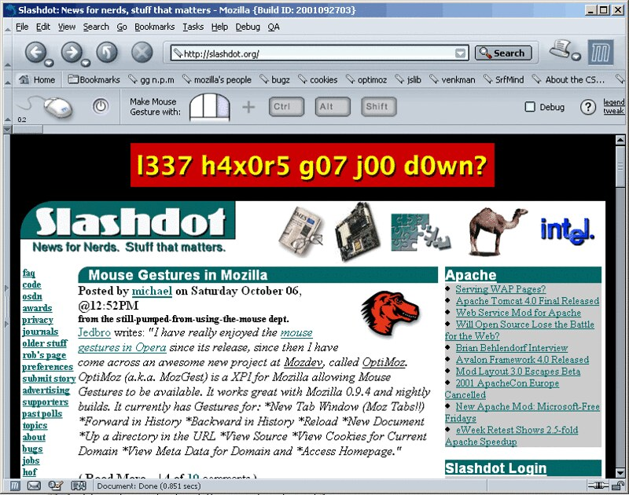

# How We Got Here: A Personal History of Cursor Instrumentation

**Andy Edmonds · updated September 4, 2026**

This library is the current iteration of a line of work I have been running in one form or another since 2001. The short version is: every time the web has reorganized itself (static pages → dynamic DOMs → recommendation feeds → AI-assisted interfaces), the cursor has needed new instrumentation, and each time the instrumentation itself has turned out to be the more durable contribution than whatever I thought I was measuring with it.

The recent part of this history is also a record of corrections: reviewer questions about what cursor features measure, collaborator discoveries of missing or misassigned page elements, and re-analysis when the measurement changed. For the current numbers and their limits, see [Current evidence](current-evidence.md). The older commit-level figures below describe what we knew at those dates.

---

## 2001 — Lucidity and real-time gesture recognition

The earliest release was **Lucidity**, a small JavaScript library I put on SourceForge (`sourceforge.net/projects/lucidity/`) for scroll-corrected cursor-entry and click-timing instrumentation on web pages. It did one thing cleanly: compute where the mouse was when the user first interacted, how long it took to get there, and how far they had scrolled to reach it. Scroll correction (adding `document.body.scrollTop` to `event.clientY` before logging) was a small thing to get right and it remained easy to lose when combining logs from different coordinate systems.

The more important thing that happened in 2001 was parallel. I was working on some gesture recognition code that was useful in principle but only ran in batch mode — you had to stop capturing, hand the buffer to the recognizer, then start capturing again. An open-source contributor from the Mozilla community picked it up and fixed it to run in real time against a live event stream. That work grew into [**Optimoz**](http://optimoz.mozdev.org/), the Firefox gesture extension hosted at `optimoz.mozdev.org`. Optimoz got [Slashdotted](https://www.flickr.com/photos/andyed/125275288/) — the front-page feature was the catapult that pulled in community contribution to the gesture recognition algorithm, and it went on to be installed by millions of Firefox users over the years that followed. The real-time fix was the enabling step: it took cursor-vector compression out of lab-report territory and into the browser of anyone who wanted it. That community contribution is a direct ancestor of my own later instrumentation work. Modern trajectory models address related representation problems with different methods; resemblance alone does not establish a chain of influence.

  
   
  <em>Slashdot front page, October 2001 — "Mouse Gestures in Mozilla." The feature catapulted community contributions into Optimoz's gesture-recognition algorithm, which in turn fed the cursor-vector compression primitive later codified in Uzilla (<a href="https://www.flickr.com/photos/andyed/125275288/">Flickr</a>).</em>

## 2003 — Uzilla and "mouse miles"

**Uzilla** was an instrumented Mozilla browser I built as my MS thesis work at Clemson under Andrew Duchowski's supervision. It was published in 2003 in *Behavior Research Methods, Instruments, & Computers* (Psychonomic Society), 35(2):194–201. Two primitives in that paper remain useful points of comparison with later cursor research:

1. **Mouse miles — integrated path length as a performance measure.** Uzilla logged the total distance the cursor traveled during a task, decomposed by horizontal and vertical direction, and reported the number alongside time-on-task and success rate as a summative usability metric. A late-2002 case study supervised by Duchowski used mouse miles to compare left-hand and right-hand navigation layouts on a real SERP-like test site at Clemson. Later work by Brückner, Arapakis & Leiva (SIGIR '21) examined mouse movement length in web-search decision tasks. The shared measurement connects the work; the later task, evaluation, and contribution deserve their own account.

2. **Cursor vector compression via the Optimoz gesture recognition algorithm.** Uzilla compressed cursor trajectories into directional-summary vectors at logging time — cited in the paper as drawing on the real-time Optimoz work. Much later, AdSight (Villaizán-Vallelado et al., SIGIR '25) learned from cursor trajectories to predict visual attention. That is a useful comparison in how trajectories are represented, rather than evidence that a learned representation is the same algorithm as Optimoz.

The [BRMIC paper](https://doi.org/10.3758/BF03202542) provides the published record for Uzilla. I distinguish that documented history from broader claims about priority or influence.

## The DOM signature

Uzilla also introduced what the 2003 paper called *"identifying path from within the document object model (DOM) of the HTML page or Mozilla browser interface"* — recording clicks not by pixel position but by the full DOM-tree path of the target element. At the time I thought of this as a practical necessity for logging clicks through dynamic pages where pixel positions kept moving between sessions.

In retrospect, the DOM signature has been one of the most durable parts of this work: a way to connect an action to a page element even when its screen position changes. Uzilla documents my use of it; that does not establish that every later DOM-path instrument descended from Uzilla. The 2026 parsing audits brought the practical problem back sharply: a stored path can resolve successfully and still identify the wrong rendered element. Element identity has to be checked as well as location.

## The ClickSense experiment

A much later thread: in 2016 I gave a talk ["Learning from Complex Online Behavior"](https://youtu.be/j38fm48gTgg?t=1348) about click-hold duration — the time between `mousedown` and `mouseup` — as a cognitive signal. The intuition was that hesitation at the click moment carries information about decision confidence. For several years the YouTube video was the only public record.

The idea eventually turned into [**ClickSense**](https://github.com/andyed/clicksense), which instruments approach geometry plus hold duration on any clickable target, page- and layout-agnostic. That thread also led to collaborative work on up/down latency. I keep the unpublished interpretation separate from the instrumentation described here.

ClickSense is the element-agnostic sibling of the library you are reading now. It answers *how was this click made?* Approach-retreat answers *what was the user doing across this list before they clicked?* The two compose on the same page.

## Why all of this ends up here

Approach-retreat brings those instrumentation habits to individual results within a ranked list. The browser library records cursor–AOI episodes; the research analyses have mainly aggregated features over each result's trial window. The four-class vocabulary—clicked, deferred, evaluated-rejected, not-approached—made it possible to ask whether non-clicked results could provide more useful supervision than one undifferentiated negative label.

That vocabulary needs care. In the LAB research, the deferred/rejected target is defined using gaze returns. The browser rules and the replay's cursor model estimate behavior from a different set of observations. Neither a retreat nor an absence of cursor contact establishes what a person thought about a result. The contribution I want to preserve is an inspectable unit of measurement and a testable proposal for supervision.

## 2026 — collaboration, review, and learning what the pages contained

The work became a collaboration as it moved toward the methods paper. Leif Azzopardi helped sharpen its framing, limitations, and conclusions; Peter Dixon-Moses contributed to the discussion of practical behavioral signals. Their involvement kept the question connected to search behavior and usable evidence. The framing increasingly moved beyond a contest between a small feature vector and a large model.

Reviewer feedback made several weaknesses clearer. We needed to show what an episode actually looked like, define the features without asking readers to reconstruct the code, explain AOI construction within the paper, and test how much click prediction depended on moving the mouse to the eventual click. I am grateful for those questions: they led to more useful controls and a clearer distinction between measuring behavior and interpreting it. The [research index](research.md) and [current evidence record](current-evidence.md) carry the resulting definitions and limits.

One useful control removed the whole final approach to the click, rather than only its last 500 milliseconds. The LAB proximity-dwell measure lost much of its click-prediction strength; the broader feature set retained information. That result made the simpler story—strong click prediction demonstrates deliberation—untenable. The removed interval can contain both motor preparation and late examination, so even the stronger control does not assign a clean psychological meaning to what remains.

### The AllSERP parsing gaps were a turning point

In late August, **Sara Al-Lawati's review of the typed AOIs exposed missing and misassigned page elements**. These were substantial measurement failures, not merely untidy labels. A model trained on the wrong result identity can give a convincing answer to the wrong question.

- **Whole local-result blocks were missing from the HTML parser's search scope.** Some Google Maps/local packs were outside `#rso`. The screenshot extractor saw a block, while the HTML parser emitted no corresponding card. Joining the two lists by index then moved labels below it by a slot. The pre-fix audit found this in **268 of 2,776 trials**, affecting the ranks of **1,930 organic AOIs**. Other HTML/CV count mismatches could produce the same cascade.
- **Parsing a saved page was not equivalent to rendering it.** Python's HTML parser and Chromium sometimes constructed different trees, especially around right-rail panels. A positional CSS path could land on a neighboring card. Identity checks and geometric alignment helped, but the repair search introduced another failure: two cards could both claim one DOM node. The collision fix removed **508 duplicate-card assignments across 454 trials**. Trials with orphaned main-column results fell from **480 to 167**; the remaining unresolved cards were not silently assigned a neighbor's geometry.
- **The carousel-cell layer had a deeper reproducibility gap.** Its released cells still derive from a frozen snapshot. The original **451/1,551 (29.1%)** count-agreement figure was subsequently retired: the checker mixed cell types and omitted zero/missing comparisons. The repaired fixed sample gives **19/61** matching top-carousel counts for that snapshot. On September 4, a reproducible DOM candidate with original-screenshot registration reached **61/61** on the same sample, including three repaired HTML/screenshot layout shifts. This is candidate geometry/count evidence, not a full-corpus release or new validation of cell-level ranking claims. [Comparison and source hashes](evidence/2026-09-04-carousel-match.json). The subsequent full-corpus check retained all 2,776 trials and the 12 alignment exclusions: the frozen source matched 465/1,575 eligible top-parent counts, while the candidate admitted 1,570/1,575 matching subdivisions (7,265 cards). The 5 rejected cases remain explicit. This clears most of the extraction work; source adoption and coordinated notebook re-derivation are still separate steps. [Full-corpus record](evidence/2026-09-04-carousel-corpus.json).

The audit also had to correct itself. An early AOI-fidelity check reused unreliable CSS paths and exaggerated the apparent low-overlap tail. Resolving by element identity changed the measured proportion above the overlap threshold from 87.0% to **93.4%** on that baseline. This was a correction to the check, not a sudden improvement in the dataset. Keeping that distinction is as important as documenting the real parser fixes.

These changes are documented in the [local-pack and alignment investigation][parsing], the [collision-fix commit][collision], and the [fidelity baseline][fidelity]. The [attribution lineage](bbox-attribution-lineage.md) separates the repaired layers from the unresolved ones. The post-collision typed substrate retains **2,764 trials after 12 alignment exclusions**; the exclusion list and content hash are part of its identity, not an incidental sample-size note.

### Correct coordinates changed the scientific story too

A separate conversion brought the mouse stream and screenshot AOIs into the same coordinate system. It changed click attribution as well as cursor distances. The rebuilt LAB outputs report a seven-feature click AUC of 0.904, compared with the earlier 0.847 anchor. A September source check adds an essential qualification: the current LAB producer samples at fixations and uses gaze–cursor distances, whereas the browser uses cursor-to-AOI distances. The newer score cannot simply replace the cursor-only deployment claim; the producer audit and a new typed cursor-only rerun are documented in the [current evidence record](current-evidence.md). Meanwhile, the advantage of behavioral grades over binary-click ranking became much smaller—roughly +0.008 to +0.010 MRR@10 in the checked grade-comparison run, rather than the older approximately +0.05. Those are different outcomes, and both belong in the history. The relative contributions of geometry, labels, and solver changes to the ranking shift remain under investigation.

A September 4 rerun then gave NB21 an explicit path from the corrected typed
AOIs through the browser library's actual feature accumulator. It also exposed
a weakness in the nominal leakage control: the recorded cursor stream had no
samples in the final 500 ms before the click, so that buffer removed nothing.
The [new typed results](current-evidence.md#september-4-a-cursor-only-typed-stream)
are reported with that limitation and their own population. Strong click
prediction remains a reason to test the terminal approach more carefully,
not a shortcut to interpreting deliberation.

The lesson I take from this stage is the same one that runs through the early instrumentation work: identifying the thing being measured comes before interpreting the behavior around it. Reviewer questions made the tests more demanding; collaborator scrutiny exposed errors in the pages those tests depended on. The current project includes those corrections and open questions, rather than ending its story at the first successful classifier.

[parsing]: https://github.com/andyed/attentional-foraging/blob/b5d66959/docs/local-pack-aoi-shift.md
[collision]: https://github.com/andyed/attentional-foraging/commit/86f800a351485af200929e8679ac35ea14377968
[fidelity]: https://github.com/andyed/attentional-foraging/blob/b5d66959/docs/aoi-fidelity-baseline-2026-08-30.md

---

## Timeline reference

| Year | Work | Contribution to this line of work |
|---|---|---|
| 2001 | Lucidity (SourceForge) | Scroll-corrected cursor entry + click-timing JS instrumentation |
| 2001– | Optimoz (`optimoz.mozdev.org`) — community Firefox gesture extension, Slashdotted, installed by millions | Real-time cursor-vector compression via gesture recognition |
| **2003** | **Uzilla (BRMIC 35(2):194–201)** | **"Mouse miles" (integrated path length), DOM-path signature, cursor-vector compression in an instrumented browser** |
| 2016 | "Learning from Complex Online Behavior" talk | Click-hold duration as a cognitive signal |
| 2026 | ClickSense | Element-agnostic approach geometry + hold duration |
| 2026 | **approach-retreat** (this library) | **Per-result cursor instrumentation and candidate behavioral supervision** |
| August 2026 | Review, AllSERP parsing audits, re-analysis | Stronger approach controls; repaired card attribution; unresolved cell layer; revised claim boundaries |

## Citations for the prior work in this history

- Edmonds, A. (2003). *Uzilla: A new tool for Web usability testing.* Behavior Research Methods, Instruments, & Computers, 35(2), 194–201. [Published record](https://doi.org/10.3758/BF03202542).
- Edmonds, A. (2001). *Lucidity* [Software]. SourceForge. `sourceforge.net/projects/lucidity/`
- Optimoz (2002). *CVS tag 0.3.4.* `optimoz.mozdev.org/gestures/` — Firefox gesture extension, cited in Edmonds 2003 for its real-time cursor vector compression.
- Brückner, L., Arapakis, I. & Leiva, L. A. (2021). *When Choice Happens: A Systematic Examination of Mouse Movement Length for Decision Making in Web Search.* SIGIR '21.
- Villaizán-Vallelado, M. et al. (2025). *AdSight: Scalable and Accurate Quantification of User Attention in Multi-Slot Sponsored Search.* SIGIR '25.
- Huang, J., White, R. W., Buscher, G., & Wang, K. (2012). *Improving searcher models using mouse cursor activity.* SIGIR, 195–204. [Author-hosted paper](https://www.microsoft.com/en-us/research/wp-content/uploads/2012/01/Final_CursorModel_SIGIR12.pdf). This is the hover-and-scroll searcher-model precedent highlighted during review; it is distinct from the three-author CHI 2012 gaze–cursor alignment paper.
- Edmonds, A. (2026). *ClickSense.* `github.com/andyed/clicksense`

---

## Code archaeology: how the per-AOI grain materialized, 2026-04-01 to 2026-05-17

**Historical reconstruction, not current validation.** Figures quoted from early commits below predate later coordinate, attribution, and validation corrections; they are retained to show how the questions developed.

The deep lineage above explains where the *primitives* came from. This section is the proximate code archaeology — six weeks of commits in two repositories during which the per-(trial, position) AOI grain went from a prose framing to a typed module boundary. It is reconstructed from `git log` across `attentional-foraging/` (AF) and `approach-retreat/` (AR) and the session-cartographer event index.

## Phase 1 — Pre-AOI: single scalar per trial. 2026-04-01 to 2026-04-04

The AF repo opened on **2026-04-01** with commit `010c0da2` — *"p(click) conditioning on mouse-gaze distance"*. One scalar per trial. Twenty other commits landed the same day (scroll dynamics, lexical priming, dataset-first README). The unit of analysis was the trial, not the result.

Per-result framing crept in over the next three days, but only in prose and process modeling:

- 2026-04-01 `c03596e5` — `docs(v2): rewrite README — lead with measurement, add per-result table`. First explicit per-result framing. No per-result data structure yet.
- 2026-04-03 `65502aec` — `§3e forward-pass vs regression episode decomposition`. Episode becomes a named unit.
- 2026-04-03 `6652be58` — `replace raw 220 ms fixation claim with episode-level reading depth`. Granularity collapsing from fixation toward episode.
- 2026-04-04 `b8f85658` — `feat: OSEC explainer — Orient–Survey–Evaluate–Commit visual essay`. The process model that predicts *why* per-result will be the load-bearing grain.

What is missing through 2026-04-04 is per-AOI code. Notebooks operate at trial grain.

## Phase 2 — NB15: per-(trial, position) cursor features land. 2026-04-05

Commit `567833cd` is the materialization moment.

> **`feat(analysis): cursor approach as covert evaluation signal (notebook 15)`**
>
> Per-result cursor approach features across 2,340 trials (15,397 result-position records).
> - 14.8 % of fixated results approached within 100 px then rejected
> - Retreat signature: 244 px rejected vs 119 px clicked (p = 5.3 × 10⁻⁹²)
> - Click prediction AUC: 0.618 (position) → 0.823 (+approach features)

The notebook header makes the conceptual move explicit:

> *"Finding #10 established the gradient: min gaze-cursor distance predicts click rate at 11× baseline. 14 % of non-clicked results had cursor within click threshold (58 px) — the 'almost clicked' set. This notebook goes deeper."*

The feature schema instantiated here is what becomes M3/M4: `min_dist, mean_dist, final_dist, retreat_dist, dwell_in_proximity_ms, mean_approach_velocity, max_approach_velocity, direction_changes, frac_decreasing`. Each row is one (trial, position) tuple. The *15,397 result-position records* phrasing in the commit message is the unit-of-analysis declaration. Per-AOI now exists as a data structure, not just rhetoric.

The notebook footer target was already explicit: *"the submission. The gain is not 'your model is wrong' but 'here's a signal your model can't see.'"*

## Phase 3 — NB21 + NB22: per-AOI gets a label scheme. 2026-04-06

Less than 24 hours later, commit `8c4e2de6` lands both companion notebooks:

> **`feat(analysis): add click prediction and 4-class taxonomy notebooks`**
>
> - Notebook 21: LOSO logistic regression for binary click prediction (AUC 0.827) and 3-class taxonomy.
> - Notebook 22: splits approached-NC into deferred vs evaluated-rejected using per-result scroll regression. Both classes separable (F1 0.70 / 0.66), zero cross-confusion.

Two things matter about NB22:

1. **The splitter was gaze regression, not cursor.** The deferred / evaluated-rejected distinction was derived from eye tracker data — the eyes coming back to a result they had already passed. The cursor was being validated as a *predictor* of a gaze-defined label. The feature named `scroll_regressed_back` in the early code reads `fix['y']`, not scroll events; the name was clarified to *gaze regression* later (commit `8c7f7de7`, 2026-04-14).
2. **NB21 fixed three methodology bugs in NB15** — participant leakage in random KFold, scaler leakage from fitting on all data, missing position+dwell baseline. The AUC 0.823 from 24 hours earlier got re-derived honestly at 0.827 under LOSO. The per-AOI grain survived the rigor pass.

The order matters: **per-AOI features came first (NB15), then the four-class label scheme used them as inputs (NB22)**. The labels are downstream of the grain, not upstream.

## Phase 4 — approach-retreat repo split. 2026-04-07

The day after NB22, the AR repo was bootstrapped. Five commits in twelve hours:

- `5bd69d1` — `feat: initial approach-retreat library and SERP experiment site`
- `b9c676e` — `feat: four-class taxonomy and fictional SERP data`. Labels ship before real data.
- `46f2ff4` — `fix retreat distance tracking`. The very first bug fixed in the new repo is per-AOI retreat geometry.
- `32976bb` — `docs: theory + one-pager, drop epistemic action framing`. The Kirsh–Maglio reading is abandoned; the library survives the theoretical reframe.
- `623f284` — `docs: reframe contribution as better negatives for ML ranking`. The labels-not-features pitch is set in writing within 24 hours of the taxonomy notebook.

The split was intentional. AF holds the science (notebooks, audits, claim IDs); AR holds the deployable instrumentation (browser library, schema, signal testbed). Same per-AOI primitive, two repos.

## Phase 5 — Forward/regressive split, M5, canonical M4. 2026-04-08 to 2026-04-15

The per-AOI grain stabilized into a public extractor. Work proceeded in parallel across both repos:

| Date | AF | AR |
|---|---|---|
| 2026-04-08 | `0771e284` forward/regressive episode split across retreat, rank, convergence, and pupil notebooks | `d361ee1` `feat(episode): forward/regressive direction classification on Episode` |
| 2026-04-13 | `1c88490a` NB22 K5 dissociation bulletproof across 50–200 px threshold | `03059d5` retract curved-close/straight-far retreat metaphor (audit fix) |
| 2026-04-14 | `8e5d5203` canonical four-class episode distributions [LAB]; `14e0d5ff` **M5 — proposed cursor-only bootstrap, later identified as gaze-gated** | `39fb0e2` adopt [LAB]/[WILD] regime convention |
| 2026-04-15 | — | `5074d34` **ship canonical M4 nine-feature extractor for v0.1.0** |

`Episode` becomes a class in AR and a split column in AF on the same day. **M5 on 2026-04-14** was framed as a cursor-only bootstrap of the gaze-defined NB22 taxonomy, LOSO AUC 0.794 *(that day's number; later reclassified as the `[absolute legacy]` gaze-gated diagnostic ceiling `[AR-V2:K9]` — the later gaze-clean nine-feature figure was 0.769 `organic` / `[AR-V2:K-bbox-1]`; the seven-feature May calibration was 0.752)*. This established the calibration direction; later audits separated gaze-gated diagnostics from gaze-clean inputs and seven- versus nine-feature models. These historical scores do not validate the current replay predictions on a new page. M4 ships the next day as v0.1.0.

## Phase 6 — AOI cascade and bbox attribution. 2026-04-28 to 2026-05-17

The schema gets exported as a stable data contract, then promoted to a typed module boundary:

- 2026-04-28 `e1ea834` (AR) — `feat(data): emit master per-(trial,position) CSV with four-class labels`. The canonical per-AOI export.
- 2026-04-30 `cee14805` (AF) — `data: per-trial AOI export keyed by canonical trial id`.
- 2026-05-01 `4555cb25` (AF) — `feat(aoi-consumer-cascade): consumer API + producer migrations + K-ID delta evidence`. The cascade architecture: one producer (NB15) emits `cursor-approach-features-*.json`; multiple consumers (NB21, NB22, NB30) read it. AOI becomes a typed boundary between code modules, not just a row schema.
- 2026-05-01 `8bb800fd` (AF) — `feat(aoi-cascade): NB15 producer migrated; cursor-approach-features-organic.json`.
- 2026-05-02 `fd10e27c` → `95bc267e` → `79cdc3dd` (AF) — NB22 + four-class taxonomy + canonical synthesis under bbox-organic attribution. The LAB anchor moves from heuristic AOIs to bbox AOIs. The earlier `[LAB] 0.821 = [WILD] 0.821` framing breaks: LAB lifts to 0.864 under cleaner attribution while WILD stays at 0.821. The divergence is reported, not papered over.
- 2026-05-05 `ac92bbb4` (AF) — `feat(aois): typed_gapfill flavor — midpoint-split + X+Y bbox click attribution`. Same day, `d6be69e6` adds the typed-cascade LTR with the four-class spec.
- 2026-05-17 `c7dd202f` (AF) — `cellsplit: paper-canonical 4-class LTR — +0.043 ΔMRR (90 % of canonical boost)`. This was the ranking evidence at the time. The cell layer subsequently failed its DOM-fidelity audit; this historical result must not be cited as current validation.

## Phase summary

| Idea-step | Code-step in AF | Code-step in AR | Days from day 0 |
|---|---|---|---|
| Trial-grain scalar | 2026-04-01 `010c0da2` | — | 0 |
| Per-result framing in prose | 2026-04-01 `c03596e5` | — | 0 |
| Episode unit | 2026-04-03 `65502aec` / `6652be58` | — | +2 |
| OSEC phase model | 2026-04-04 `b8f85658` | — | +3 |
| **Per-(trial, position) cursor features (NB15)** | **2026-04-05 `567833cd`** | — | **+4** |
| Per-AOI + four-class label (NB21+NB22) | 2026-04-06 `8c4e2de6` | — | +5 |
| Repo split | — | 2026-04-07 `5bd69d1` | +6 |
| Forward/regressive on `Episode` | 2026-04-08 `0771e284` | 2026-04-08 `d361ee1` | +7 |
| M5 calibration proposal (gaze dependence clarified later) | 2026-04-14 `14e0d5ff` | — | +13 |
| Canonical M4 extractor v0.1.0 | — | 2026-04-15 `5074d34` | +14 |
| Per-(trial, position) CSV export | — | 2026-04-28 `e1ea834` | +27 |
| AOI cascade producer / consumer API | 2026-05-01 `4555cb25` | — | +30 |
| Typed AOI cascade + paper-canonical LTR | 2026-05-05 `ac92bbb4` / `d6be69e6`, 2026-05-17 `c7dd202f` | — | +30 to +46 |

## Reading the arc

The per-AOI idea did not arrive as a deliberate design choice. It arrived as a data shape that survived a sequence of empirical surprises. The chronology shows an empirical development rather than a completed theory being implemented unchanged:

1. **NB10's "almost-clicked" set** — ~14 % of non-clicked results within click threshold — created a population that only existed at per-result grain. Trial-level couldn't see it.
2. **NB15 (2026-04-05)** computed per-result cursor approach features to characterize that population. AUC jumped from 0.618 (position) to 0.823 (position + approach features).
3. **NB22 (2026-04-06)** used per-result gaze regression to split "approached but didn't click" into deferred vs evaluated-rejected. The dissociation was clean (F1 0.70 / 0.66, zero cross-confusion), which motivated testing the taxonomy as a supervision target. Separation of constructed classes did not establish relevance ground truth.
4. **AR repo (2026-04-07)** wrapped the per-(trial, position) extractor in a browser library and renamed the contribution from "epistemic action" to "better negatives for ML ranking" — a change in the question posed to the measurements. The ranking proposal still required downstream validation.
5. **M5 (2026-04-14)** established a calibration direction. Its 0.794 result was later identified as gaze-gated; subsequent gaze-clean runs tested inference without gaze. The later WILD experiment tested binary ad clicks, not recovery of gaze-defined deferred/rejected classes.
6. **The cascade migration (2026-05-01)** turned per-AOI from a row schema into a typed module boundary. Producers emit `cursor-approach-features-*.json`; consumers don't recompute. Per-AOI stopped being a notebook convention and became an architectural commitment.

Per-AOI emerged on **2026-04-05** in NB15 as a unit-of-analysis declaration — *15,397 result-position records, not 2,340 trials*. It held through six weeks of audits, repo splits, attribution rewrites, and rigor passes because every empirical follow-up needed the same row shape to land.
